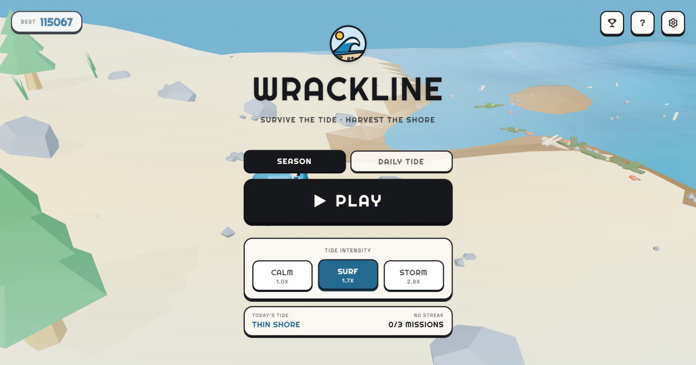
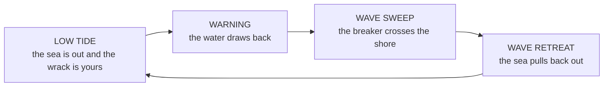
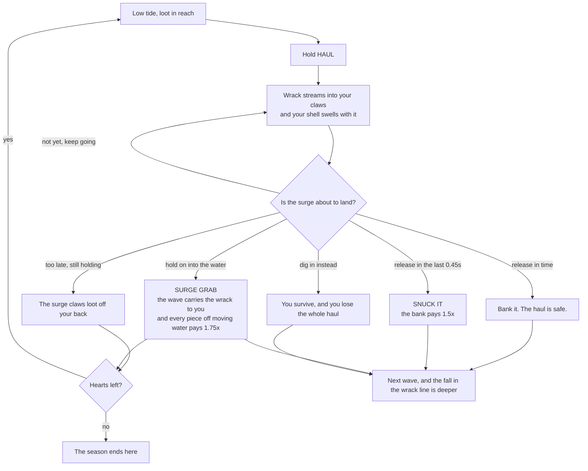
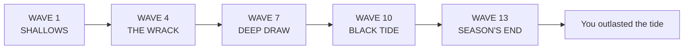
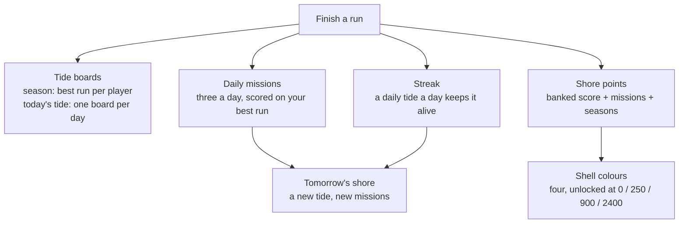
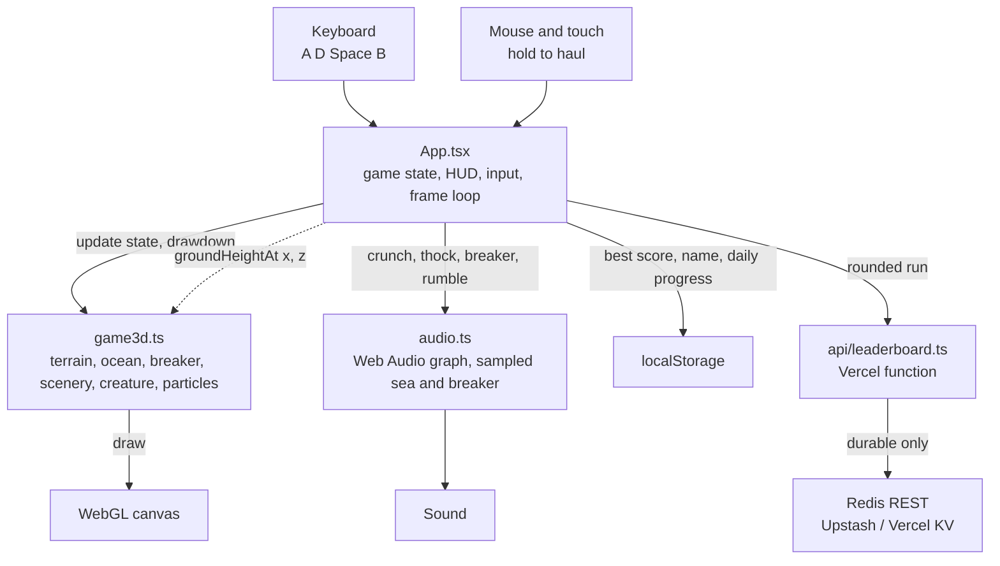

<div align="center">
  
  <h1>WRACKLINE</h1>
  <p><strong>Survive the tide. Harvest the shore.</strong><br />
  A seaside arcade game about greed, timing, and thirteen waves of incoming water.</p>

  <p>
    <a href="https://wrackline.sithunyein.com"></a>
    <a href="LICENSE"></a>
    <a href="https://github.com/thesithunyein/wrackline/commits/main"></a>
    <a href="https://github.com/thesithunyein/wrackline/stargazers"></a>
  </p>

  <p>
    
    
    
    
    
  </p>

  <p>
    
    
    <a href="CONTRIBUTING.md"></a>
  </p>
</div>



## Submission

| # | Item | Answer |
|---|---|---|
| 1 | **Game title** | **WRACKLINE** — *Survive the tide. Harvest the shore.* |
| 2 | **Team name** | **Solo Canvas** — a one-person team |
| 3 | **Main contact** | Team leader **Sithu Nyein** — [sithunyein.mailto@gmail.com](mailto:sithunyein.mailto@gmail.com) · Telegram [@thesithunyein](https://t.me/thesithunyein) |
| 4 | **Short description** | A seaside arcade game about greed and timing. You are a hermit crab working a storm beach: hold your nerve through the low tide, pull the wrack into your shell, and get off the sand before the breaker lands on you. Thirteen waves, four shell colours, a daily shore. |
| 16 | **Repository access** | Public: https://github.com/thesithunyein/wrackline. Submission tag **`v1.1.2`** (`git rev-parse v1.1.2` for the exact commit). |
| 17 | **Build version** | **1.1.2** — tag `v1.1.2`, deployed to production at https://wrackline.sithunyein.com on 2026-10-31. |

### 5. How to open and play

Open **https://wrackline.sithunyein.com** in a browser. There is nothing to install, no account and no
login: the title screen loads straight into the game. Press **PLAY**, scuttle with `A`/`D`, and hold
`Space` to haul. The first run takes about two minutes; `R` or `Enter` on the end screen starts the
next one. The same build is also served from https://wrackline.vercel.app.

### 6. Supported browsers

| Browser | Status |
|---|---|
| Chrome / Edge (Chromium 120+) | **Tested**, desktop and phone-sized viewports |
| Firefox 128+ | Smoke-tested during development; not a full gameplay pass |
| Safari 17+ (macOS / iOS) | Expected to work; **not tested** — no Apple hardware was available |

The game needs **WebGL2** and **Web Audio**. If WebGL is unavailable the canvas does not start, and
the shell portraits in the daily sheet fall back to flat colour swatches.

### 7. Supported devices

- **Desktop / laptop** with a keyboard and mouse — the intended way to play.
- **Phones** with touch — the same game, with on-screen arrows, HAUL and DIG buttons. Verified at
  390x844 (iPhone 14-class viewport) in Chromium; smaller widths are untested.
- **Tablets** — should work, untested.
- Hardware acceleration should be on; the renderer caps device pixel ratio at 1.5 on narrow frames
  and 1.75 on wide ones to protect the frame budget.

### 8. Controls and gameplay instructions

| Action | Keys | Touch |
|---|---|---|
| **Scuttle** | `A` / `D` or `←` / `→` | on-screen ◀ ▶ |
| **Haul** | Hold `Space`, or hold the mouse button | hold anywhere on the shore, or hold HAUL |
| **Bank** | Release `Space` / the pointer | release |
| **Dig in** | Hold `B` or `Shift` | hold DIG |
| **Pick the tide** | `1` / `2` / `3` on the title screen | tap CALM / SURF / STORM |
| **Pause** | `Esc` or `P` | tap pause |
| **Play again** | `R` or `Enter` on the end screen | PLAY AGAIN |
| **Sound on/off** | `M`, or gear → SOUND | gear → SOUND |
| **Fullscreen** | `F`, or gear → FULLSCREEN | desktop only |
| **Language** | gear → LANGUAGE (English / မြန်မာ) | same |
| **Tide boards** | trophy button | trophy button |
| **Guide** | `?` button | `?` button |

A run is **thirteen waves**. Walking is not the risk; holding is. The surge only takes a heart if it
catches you with loot on your back, so every wave is a bet on how long you dare hold. Releasing in
the last 0.45 seconds before the water lands pays a 1.5x **snuck bank** bonus. Hauling while the
surge is already on the shore pays 1.75x, because holding into the water is what costs you.

Between runs: **season** is the thirteen-wave run scored against everyone; **today's tide** is the
same shore and the same wrack placement for every player that day, with three missions, a streak,
and a daily board. Banking, missions and finished seasons earn shore points that unlock four shell
colours at 0 / 250 / 900 / 2400.

### 9. Known bugs and limitations

1. **Burmese medial ra (ြ, U+103C) can draw as a dotted box** in the Burmese UI. It reproduces with
   Noto Sans Myanmar, Aka08, Padauk and plain system fonts on the same Windows machine, and on live
   Burmese Wikipedia, so it is the platform's text shaper rather than these strings or this
   stylesheet. Not fixed; it may not appear on other machines.
2. **The leaderboard is self-reported.** The endpoint caps a score at what the game can physically
   pay out in the run time it claims, which stops a lazy `localStorage` edit but not a determined
   cheater. There is no login and no replay validation, and the README does not pretend otherwise.
3. **Fullscreen is unavailable on iOS Safari** (the API only covers video there). The settings row
   is disabled rather than lying about it.
4. **No offline mode.** After the app has loaded a run needs no network, but a reload with no
   connection fails: there is no service worker.
5. **`package.json` declares five libraries the game no longer imports** — `express`,
   `@google/genai`, `lucide-react`, `motion`, `dotenv`. Harmless at runtime (tree-shaken out of the
   bundle); trimming them is outstanding cleanup.
6. **The JavaScript bundle is 902 KB raw / 239 KB gzip**, almost all of it Three.js.
7. **Frame time measured in development was ~35 fps** (28 ms median) on the review machine in
   headful Chrome, below the 60 fps target; that machine is known to run slow, and real-device
   numbers are still wanted.

### 10. Third-party tools and libraries

| Library | Licence | Used for |
|---|---|---|
| **React 19** + **react-dom** | MIT | UI state, HUD, menus |
| **Three.js r186** | MIT | the entire 3D world: terrain, ocean, breaker, props, creature, particles |
| **Vite 8** + `@vitejs/plugin-react` | MIT | dev server and production build |
| **Tailwind CSS v4** + `@tailwindcss/vite` | MIT | HUD and menu styling |
| **TypeScript 7** (`tsc --noEmit`) | Apache-2.0 | type checking; no emit |
| **tsx** + **Node's `node:test`** | MIT / Node licence | the 44-test suite |
| **esbuild** | MIT | transitive build dependency |
| **Vercel** (host + serverless function + KV/Upstash Redis REST) | hosted service, not shipped code | hosting, `/api/leaderboard`, durable board storage |

No game engine, physics library or audio library is used: the loop, the tide state machine, the
procedural audio graph and the share-card painter are written in this repository.

### 11. Asset credit list

Every asset the submission contains or loads, and where the right to use it comes from. Nothing is
copied from another game, and no stock art, models, textures or samples are used; the two audio
files are generated audio made for this entry, not sampled from anything.

| Asset | What it is | Author / origin | Licence or permission | Shipped as |
|---|---|---|---|---|
| **Game code** (`src/`, `api/`, `server/`, `tests/`) | the game, the leaderboard endpoint and its tests | written for this entry by Team Solo Canvas, 2026-10-15 to 2026-10-31 | MIT (`LICENSE`) | repository |
| **Shore, ocean, breaker, props, particles** | 3D geometry built procedurally at runtime | generated by `src/game3d.ts` | original work, no third-party data | no files |
| **Crab creature and shell portraits** | the character and its four shell colours | generated in `src/game3d.ts`, `src/shellPreview.ts` | original work | no files |
| **Logo mark, wordmark, UI icons** | vector shapes drawn in code | `src/logoMark.ts`, `src/Logo.tsx` | original work | code, plus `docs/logo.svg` |
| **`docs/logo.svg`** | the mark exported on its own | export of the same code output | original work | repository |
| **`public/og.png`** | title-screen social card | screenshot of this game's own title screen | original work | repository |
| **Share card** | the 1080x1350 run card | painted at runtime by `src/shareCard.ts` | original work | generated per run |
| **Sound effects** | haul, bank, heart, warning rumble, impact, UI cues | synthesised at runtime by `src/audio.ts` | original work; no bought libraries | no files |
| **`public/audio/wavebg.mp3`** | the sea bed under the whole game, 11.2 s loop, 260 KB | **AI-generated for this entry**; declared in §15 | generated, not sampled from any existing recording; no third-party rights involved | repository, served from the game's own `/audio/`, crossfaded into a seamless loop at load |
| **`public/audio/wave.mp3`** | the breaker's swell and crash, 4.2 s, 95 KB | **AI-generated for this entry**; declared in §15 | generated, not sampled from any existing recording; no third-party rights involved | repository, served from the game's own `/audio/` |
| **Righteous** | display typeface | Astigmatic, via Google Fonts | SIL Open Font License 1.1 | fetched at runtime, not bundled |
| **Space Grotesk** | UI typeface | Florian Karsten, via Google Fonts | SIL Open Font License 1.1 | fetched at runtime, not bundled |
| **Noto Sans Myanmar** | Burmese fallback face | Google, via Google Fonts | SIL Open Font License 1.1 | fetched at runtime, not bundled |
| **Aka08** | Burmese interface face | Moezed, via the `saturngod/myanmar-unicode-fonts` CDN | **no licence declared** — see the note below | fetched at runtime, not bundled, not redistributed |
| **Three.js, React, Vite, Tailwind, TypeScript, tsx, esbuild** | code libraries | the projects named in §10 | MIT, except TypeScript (Apache-2.0) | bundled in the build |

**Disclosure on Aka08.** The font's name table reads "Copyright (c) 2025 by Moezed. All rights
reserved." with no licence text, so no written grant exists to point at. It is used only for the
Burmese interface, it is fetched at runtime from the author's published CDN rather than copied into
this repository or into any build, and the interface falls through to Noto Sans Myanmar (SIL OFL
1.1) whenever it fails to load. It is named here rather than left implicit: if a licence of record
is required for every asset, removing it is a one-line change to the font stack and the game is
unaffected apart from the Burmese glyph style.

**Not in the submission:** no third-party art, 3D models, textures, HDRI maps, music, voice or
sound files; no trademarks, stock photography or scraped data; no personal or confidential
information about any person. The only audio files in the repository are the two generated ones
above; they are the only non-synthesised sounds in the game.

### 12. Special testing instructions

```bash
npm install --legacy-peer-deps   # npm's resolver trips over an esbuild peer range
npm run typecheck                # tsc --noEmit
npm test                         # 44 tests over leaderboard, retention, loot, i18n and the wave clock
npm run dev                      # http://localhost:3000
npm run build && npm run preview # production bundle
```

- **Judging the board without a database:** `npm run dev` (and any host without KV variables) has no
  `/api/leaderboard`. The client detects the failure, keeps the score on the device and labels the
  sheet "ON THIS DEVICE". That is the intended fallback, not a crash.
- **Daily content:** the day key is computed in **Myanmar time (UTC+06:30)** on the server, never
  sent by the client, so today's tide and board roll over at 18:30 UTC.
- **Viewports used for the last pass:** 1280x800 (desktop) and 390x844 (phone). Both were checked
  for header order, the settings sheet, language persistence across reload, and the shell portraits.
- **Suggested five-minute test:** play one SURF run to wave 4, release a haul inside the warning
  window to see **SNUCK IT**, get caught holding once to see a heart go, then open the trophy sheet
  and switch the language to မြန်မာ and back.

### 13. Recommended orientation, resolution and aspect ratio

- **Landscape, 16:9** is the intended presentation: 1280x720 or larger, up to 1440p.
- **Phones play in portrait** — the camera reframes for aspect ratios below 1.0 and the touch
  controls move to the bottom edge. Portrait is fully supported, not a fallback.
- Anything from **16:10 to roughly 4:3** is fine; the camera framing is applied from the aspect
  ratio at load and on resize.

### 14. Internet connection and external services

| Requirement | Needed for | If it is missing |
|---|---|---|
| **https://wrackline.sithunyein.com** (a Vercel deployment) | loading the game | nothing to play |
| **Google Fonts** (Righteous, Space Grotesk, Noto Sans Myanmar) | the typography | system font stack; the game still plays |
| **jsDelivr** (Aka08 TTF) | Burmese interface only, ~118 KB | Burmese falls back to Noto Sans Myanmar |
| **`/api/leaderboard`** on Vercel | world boards and score submission | the on-device board, labelled as such |
| **Upstash / Vercel KV (Redis REST)** | durable storage behind that endpoint | the endpoint answers `503` with `storage: "unavailable"` and the client keeps the local board |

A run itself makes **no network calls beyond two own-host fetches**: the sea bed
(`/audio/wavebg.mp3`, 260 KB) and the breaker (`/audio/wave.mp3`, 95 KB) are pulled once, at the
first key press or tap, and decoded in memory. Everything else — the geometry, the other sounds,
the share card — is generated locally, and the score is posted once at the end.

### 15. AI use declaration

| Tool | Purpose | Affected code or assets | Human review and modification |
|---|---|---|---|
| **Qoder** (agentic coding IDE, Claude-family model) | implementation assistance: scene code, game state, UI, i18n, settings sheet, tests, build config, this README | most of `src/`, plus `api/leaderboard.ts`, `server/leaderboardStore.ts`, `tests/`, `index.html`, `vite.config.ts`, `README.md` | every change read and approved line by line before commit; `tsc --noEmit` and the 44 `node:test` cases run on each change; the production build played in Chrome at 1280x800 and 390x844 before it shipped; the model's mistakes were caught and fixed (the settings icon was first drawn as a sun, the Burmese face first hijacked the Latin wordmark), and every tuning constant is the developer's, set from measured playtests |
| **Qoder** | throwaway verification scripts | `pt/` — puppeteer-core, font-inspection and screenshot scripts kept outside the repository | used only to measure this build; not part of the submission |
| **An AI audio generator** (provider and version not recorded at generation time) | the sea bed and the breaker, `public/audio/wavebg.mp3` and `public/audio/wave.mp3` | the ambient wash under play and the swell and crash of the wave, generated rather than recorded | both files were auditioned in the built game against the rest of the mix; the sea bed is crossfaded into a seamless loop at load and hushed under each breaker, and the breaker is trimmed by playback envelope in `src/audio.ts` and layered over a synthesised sub-bass thump; they are the only AI-generated assets in the submission |

- **Two AI-generated audio assets.** The sea bed (`public/audio/wavebg.mp3`) and the breaker swell
  (`public/audio/wave.mp3`, §11) were generated with an AI audio tool rather than recorded or
  sampled. The sea bed plays under the whole game, is crossfaded into itself at load so the loop
  has no seam, and is hushed when the breaker lands so the wave owns the moment; the breaker is the
  one sound the surge itself makes. Both are declared here, credited in §11 and named in §18.
  Everything else audible is a Web Audio graph built in `src/audio.ts`; if either file fails to
  load, the game falls back to the synthesised sea and crash it used before.
- **No AI-generated art, voice, 3D models or textures.** Everything visible is procedural code
  (Three.js geometry, canvas painting). The only raster in the submission, `public/og.png`, is a
  screenshot of the game's own title screen.
- **No AI at game time.** The game calls no model or AI service; no AI SDK is imported anywhere in
  `src/`, `api/` or `server/`.
- **Nothing confidential was sent to the tool.** No credentials, personal data or third-party
  proprietary material were pasted into it; the KV credentials exist only as Vercel environment
  variables and appear in neither the repository nor a prompt.
- **Responsibility.** The team understands, tests and maintains all of the submitted code,
  including the AI-assisted parts, and can explain any file in the repository on request.

### 18. Originality declaration

Team **Solo Canvas** confirms:

1. **Newly developed during the competition period.** The game was built in this repository: the
   history starts with the project's own initial commit on 2026-10-15 and every commit is dated
   between then and 2026-10-31. No code, asset or commit was imported from an earlier project.
2. **Not copied from another game.** The mechanics (a haul-you-can-lose loop, a wave clock, hearts,
   missions, a daily shore), the tuning, the geometry, the UI and the Web Audio graph were written
   from scratch for this entry. The two audio samples are AI-generated, made for this entry and
   declared in §15; they copy no existing recording. No code, art, level or data was taken from
   another game.
3. **Not commercially available and not on any public market.** The game has never been sold,
   licensed or listed on a store or marketplace. https://wrackline.sithunyein.com is a free public
   build with no ads, purchases, subscriptions or accounts, hosted so judges and players can open
   it; there is no commercial release.
4. **Right to use all assets.** Every asset is original work, MIT, Apache-2.0 or SIL OFL 1.1, as
   itemised in §11 — with the sea bed and breaker samples, which were AI-generated for this entry
   and are declared in §15 — and with one disclosed licence exception: the Aka08 Burmese face
   carries no licence grant. It is fetched at runtime from its author's public CDN, is not redistributed in the
   repository or in any build, is used only for the Burmese interface, and the UI falls back to Noto
   Sans Myanmar (SIL OFL 1.1) without it. Removing it is a one-line change.
5. **No infringement of third-party rights.** The name WRACKLINE, the mark, the wordmark, the
   creature and the shore are original to this entry. No third-party trademarks, stock images,
   audio samples or scraped data are used; both water samples are generated for this entry, not
   sampled from anyone's recording.
6. **Proof of originality available on request.** The development history, the file tree and this
   document are in the public repository; the deployed build is the tagged commit.
7. **All material AI assistance is disclosed** in §15, including the affected files and the human
   review behind them.
8. **The repository and its history are accurate.** One author (two spellings of the same name and
   email), a linear history with no imported, squashed or generated commits, and no secrets
   committed. The deployed production build is tag `v1.1.2`.

Signed for the team: **Sithu Nyein**, Solo Canvas — 2026-10-31.


## What this is

A seaside arcade game about tide timing and loot hauling. You are a hermit scuttler working a
storm beach: hold your nerve through the low tide, pull the wrack into your shell, and get off the
sand before the breaker lands on top of you.

Every wave gives you the same choice, and it is the whole game. The longer you hold, the more you
stand to bank, and the more the surge can tear off your back.

**Play it:** https://wrackline.sithunyein.com (a keyboard, a mouse or a thumb all work)

## Contents

- [Submission](#submission) — the submission checklist: title, team, contact, controls, browsers,
  devices, limitations, licence, credits, AI use, originality, version
- [How to play](#how-to-play)
- [Settings, sound and language](#settings-sound-and-language)
- [How it works](#how-it-works)
- [Running it locally](#running-it-locally)
- [Deployment](#deployment)
- [How it is built](#how-it-is-built)
- [Project layout](#project-layout)
- [Contributing](#contributing)
- [Security](#security)
- [License](#license)

## How to play

| Action | Keys | What it does |
|---|---|---|
| **Scuttle** | `A` / `D` or `←` / `→` | Walk the shore. Deeper sand holds richer wrack and a longer walk back. |
| **Haul** | Hold `Space`, or hold the screen | Everything within claw reach, about six units of beach either side of you, streams into your shell. Everything further out stays where it lies until you scuttle over to it, which is the whole reason the far, fatter pieces are worth more. The water counts as reach: hauling while the surge is on the shore pays **1.75x**. Keep holding and your shell swells, and a swollen shell is a wider target. |
| **Bank** | Release `Space` | The haul is stowed and safe. It counts immediately. |
| **Dig in** | Hold `B` or `Shift` | Burrow under the sand. The surge passes over you, and it takes everything you were holding. A 0.3 second wind-up makes it a commitment rather than a reflex. |
| **Pick the tide** | `1` / `2` / `3` on the title screen | Calm, Surf or Storm. |
| **Pause** | `Esc` or `P` | The tide holds while you are away; switching tabs pauses too. |
| **Share** | `SHARE` on the end screen | Saves a 1080x1350 PNG of the run: the mark, your name, and your best score. Asks for the name once, then remembers it. |

Walking is not the risk. Holding is. Releasing your haul the instant the water arrives is the
difference between a good wave and a lost one.

Holding into the water is its own gamble, and the game is built to reward it. While the surge is on
the shore the wrack floats, and the wave carries it: the breaker pushes it up the beach as it runs
in and drags it back out as it leaves. A piece you could not reach in the low tide can therefore be
lifted straight off the moving water for **1.75x** its worth, and the grab says `SURGE`. What it
costs is the old rule, unchanged: a surge that catches you holding takes a heart, and while it has
you the water claws pieces back off your back, about one and a half pieces a second. The bonus is
what that risk buys, not free money.

### Tides

| Tide | Multiplier | Low tide (wave 1) | Warning | Hearts | Character |
|---|---|---|---|---|---|
| CALM | 1.0× | 7.0s | 1.8s | 4 | Long low tide, slow breaker, forgiving window |
| SURF | 1.7× | 5.0s | 1.3s | 3 | The default. A fair fight between greed and escape |
| STORM | 2.8× | 3.6s | 0.9s | 2 | Short low tide, fast breaker, slower claws |

### The season

A run is **thirteen waves**. Survive all of them and you have outlasted the tide. Hearts are the
only losing condition, so water never ends a run by surprise, and the wrack line never kills you.
It just keeps eating the shore, which makes the closing waves thinner pickings.

| Waves | Stretch |
|---|---|
| 1 to 3 | SHALLOWS |
| 4 to 6 | THE WRACK |
| 7 to 9 | DEEP DRAW |
| 10 to 12 | BLACK TIDE |
| 13 | SEASON'S END |

The calm between surges shrinks all season rather than flattening out at wave seven, so wave
thirteen is genuinely the tightest wave in the run.

### The wave clock is a roll, not a metronome

The figure in the table above is the **centre** of a wave's low tide, not its length. Every wave
rolls its own window around that centre, so the next surge can never be counted down from the last
one:

| Roll | Share | Low tide | What it is for |
|---|---|---|---|
| **sneak** | 30% | 0.42× the centre | The shore is open for about one crossing. On SURF that is a **2.1s** window in the opening waves, and about **3.3s** counted from the start of the calm to the surge — the pressure the closing wave of the season used to hold, arriving on wave two |
| **ordinary** | 58% | 0.78× to 1.18× the centre | The window the season has earned, so the ladder still reads |
| **breath** | 12% | 1.45× the centre | A long one, so a run of short hushes is not the whole story and greed has somewhere to pay |

Measured over 2,000 simulated SURF seasons, the calm from the water pulling back to the surge
coming in runs from **2.4s** to **8.2s** with a median of **4.5s**, against a fixed 6.3s down to
3.6s before. A season holds about four sneaks and one or two breaths.

Two rules keep it fair. The **warning is untouched**: the sea draws back for the full 0.9 to 1.8
seconds on every wave at every tide, so an unexpected surge is still announced, and the reaction
window is the one the tide table promises. And the **opening wave is never a sneak**, because the
first low tide is where the controls are learned. Today's tide rolls the clock on its own seeded
stream, so every player gets the same beats as well as the same wrack.

### Season, or today's tide

The menu starts either a season — the run above, scored against everyone's best — or **today's
tide**, which is the same shore with one modifier laid over it and the same wrack in the same
places for every player that day. The daily board is one board per day, so it compares runs played
under the same rules. Three missions sit on top, scored on your best run of the day, and a daily
tide a day keeps your streak alive. Banking, missions and surviving seasons earn shore points,
which unlock the four shell colours.

### Four moments the game is built around

- **The draw.** The low tide never shows you everything: roughly two in five pieces of a wave are
  still out on the water, and they wash in while the sea is already drawing back, one to three
  drops at a time. Every one of them lands at the waterline, where the surge arrives first and where
  a piece is worth the most. Without them the beach could be cleared and banked before the warning
  was even called, which made the whole greed decision optional.
- **The King Tide.** From wave three on, a wave can roll in as a King Tide and pay **double** on
  everything you bank during it. The odds climb as the run goes on, it never lands twice in a row,
  and three dry waves guarantee the next one rolls. It is the reason a cautious run still has a
  moment worth gambling on.
- **The snuck bank.** Release your haul inside the last 0.45 seconds of the warning, with the surge
  already moving, and the bank pays a **1.5× near miss bonus**, once per wave. Ten frames of
  slow motion mark it. This is the moment a run gets remembered for, and it only pays once per
  wave on purpose: if every bank paid the bonus, the greed decision would stop meaning anything.
- **The surge grab.** The water is the threat, and it is also the best larder on the beach. Haul
  while the surge is on the shore and the wave carries wrack to your claws for **1.75x**, so the
  pieces left stranded up at the waterline come to you instead of going back out with the tide.

Get caught holding loot and the surge claws it off your back, about one and a half pieces a second,
and you lose a heart. Lose the last one and the wave takes you.

## Settings, sound and language

The header carries three buttons, left to right: **tide boards** (trophy), **the guide** (`?`) and
**settings** (gear). Everything that used to sit loose in the header — the speaker and the
fullscreen toggle — lives inside the settings sheet now, next to the language switch.

| Setting | What it does | Also on a key |
|---|---|---|
| **Sound** | Waves, clicks and the shore. Off survives a reload. | `M` |
| **Language** | The whole shore, labels and guide: **English** or **မြန်မာ**. Survives a reload. | — |
| **Fullscreen** | Fills the screen. Hidden as disabled where the browser has no API for it, which includes iOS Safari. | `F` |

- **The language is the whole interface**, not a menu toggle: HUD, pause, guide, missions, end screen,
  boards, the name prompt and the share card all read through one dictionary
  (`src/game/i18n.ts`), with English as the key and English as the fallback.
- **Burmese gets its own type.** Righteous and Space Grotesk are Latin-only, so `html[lang='my']`
  swaps in **Aka08** (scoped to the Myanmar Unicode blocks so the wordmark stays Righteous), scales
  it 112% so the small labels stay legible, and pulls the game's wide signage tracking back down to
  0.01em, because that spacing breaks stacked Myanmar clusters apart into loose syllables.
- **The language label is never translated.** Someone looking for their own language has to be able
  to read it, so the Burmese option always says မြန်မာ, in Burmese, in both languages.
- **The shell row is the creature, not a colour chip.** Each of the four unlocks renders the same
  low-poly crab the shore uses, in that shell's colour, once per colour through a single throwaway
  renderer. Locked shells are drawn greyscale; the one you are wearing sits on the gold card.
- **Accessibility:** keyboard focus rings, `prefers-reduced-motion` honoured for the pulsing hints,
  safe-area insets on notched phones, and pinch-zoom is left enabled.

## How it works

Four views of the same machine, from the tide itself down to the code that draws it.

### The tide cycle

Every wave runs the same four phases. The breaker is a state machine, not a script.



### The decision

This is one wave from the player's side. Every arrow that says keep holding is a bet against the
next one.



### A run

Thirteen waves, four named stretches, one ending you want.



Later waves are tighter in three ways at once: the centre of the low tide window multiplies down as
the run goes on, the wrack line retreats eight units per surge so there is less to gather, and the
King Tide odds climb.

### Beyond one run

A run is the game. Around it sit four things that give a reason to start another one — today,
tomorrow, and for a shell colour that has to be earned.



- **The daily tide is one shore for everyone.** A modifier is chosen from the Myanmar date
  (`RICH WRACK`, `THIN SHORE`, `LONG DRAW`, `KING SEASON`, `SHORT FUSE`) and the run's randomness is
  seeded from the same date, so the wrack lands in the same places for every player who plays it
  before the day turns at UTC+06:30. The board for that day is filed under a day key the *server*
  computes, never one the client sends.
- **Missions are per-run bests, not running totals.** "Bank 2,000 in a single tide" cannot be
  completed by two runs of 1,200, which is the point: they ask for a better run, not more runs.
- **A season run still counts toward missions; only a daily tide moves the streak.** The streak is
  a record of showing up on a day, and a season run does not prove that.
- **The on-device board always works.** The world board is used only when the endpoint reports
  durable storage; otherwise the board sheet says "on this device" and shows the run kept here.


### How the code fits together



### Things worth knowing in the code

- **`src/game3d.ts` owns the scene.** Gameplay state lives in `App.tsx` and is pushed into the
  engine once per frame through `Wrackline3D.update()`.
- **`groundHeightAt( x, z )`** is the single source of truth for where the beach surface is.
  Scenery, loot and the player are all bedded onto it, so nothing floats or sinks as the slope
  changes across the shore.
- **The sea is calm where it meets the beach.** The swell is damped over the last fourteen units of
  shore, so the water surface is never below the sand it is meeting: the waterline is a line rather
  than a breathing band, and the draw bares beach instead of seabed.
- **The breaker is re-draped every frame.** `waterSurfaceY()` returns the waterline under the wave
  (the sand it is crossing, or sea level once the beach drops below it) and the swell, foam and
  shallow sheet are rebuilt on top of it. That is what keeps the surge attached to the sea instead
  of reading as a separate slab sliding over dry sand.
- **Greed is drawn, not just counted.** The shell visibly swells with the value riding on it, and
  that swell is read back as a hitbox, so a fat scuttler really is easier to catch than a lean one.
- **The share card is drawn, not screenshotted.** `src/shareCard.ts` paints a 1080x1350 PNG of the
  run on a canvas: the mark, the name, the record, and the season's result. The mark's shapes live
  in `src/logoMark.ts` so the card and the in-page logo cannot drift apart, and the whole thing is
  rasterised on the device, which is why there is no image endpoint and nothing to upload.
- **SHARE saves a file, and asks for a name only once.** The first press on a device with no name
  stored opens a prompt and keeps the answer in `localStorage`, so later presses save straight
  away; the picture lands in Downloads as `wrackline-<name>-<best>.png`. The save is an anchor
  download rather than `navigator.share` on purpose: handing the file to a share sheet gives it to
  another app, and a sheet that is dismissed or that never resolves has not saved anything.
- **Every ending has a cause.** A run ends because hearts ran out or because thirteen waves were
  survived, and the end screen names which one.
- **The frame budget is spent on pixels, not on bookkeeping.** Every material in the scene is
  `flatShading`, which derives its normals in the fragment shader, so the per-frame
  `computeVertexNormals()` calls on the non-indexed water meshes were pure waste and are gone. The
  renderer caps the device pixel ratio at 1.5 on a narrow frame and 1.75 on a wide one (a phone
  reporting 3 was drawing nine times the pixels it needed), the shadow atlas is 1024 on a phone and
  1536 on a desktop instead of 2048 everywhere, and the particle materials are shared rather than
  created per spray, dust or haul puff.

## Running it locally

```bash
npm install --legacy-peer-deps   # npm's resolver trips over an esbuild peer range
npm run dev                      # http://localhost:3000
npm run build                    # production bundle in dist/
npm run typecheck                # tsc --noEmit
npm test                         # node test runner over the board and retention rules
```

`--legacy-peer-deps` is only needed for a clean install; an existing `node_modules` is fine.

Vite serves the game but not `api/`: in `npm run dev` the board request answers 404 and the game
does exactly what it does on a host without storage — it keeps the score on the device and says so.

## Deployment

The game is a static bundle plus one serverless function, so any host with functions works. It is
currently on Vercel and answers on **https://wrackline.sithunyein.com**; `wrackline.vercel.app`
remains attached to the same project as an alias, so both addresses serve the same build and the
same board.

```bash
npm run build                              # check it locally first
vercel deploy --prod --project wrackline   # serves dist/ and api/leaderboard.ts
```

The world board needs durable storage, and is only enabled when the function can find it:

```bash
vercel env add KV_REST_API_URL production     # or UPSTASH_REDIS_REST_URL
vercel env add KV_REST_API_TOKEN production   # or UPSTASH_REDIS_REST_TOKEN
```

Without those two the endpoint answers `503` with `storage: 'unavailable'`, and the client keeps
the on-device board instead of pretending a server is holding the score. The function also reads
`LEADERBOARD_KV_REST_URL` / `LEADERBOARD_KV_REST_TOKEN`, so a dedicated database can be used
without colliding with another project's keys. The board's own keys are namespaced under
`wrackline:leaderboard:*`, and the daily board lives at `daily:<YYYY-MM-DD>` in Myanmar time.

## How it is built

- **React 19 + TypeScript + Vite 8**, with Tailwind CSS v4 for the HUD and menus.
- **Three.js** renders the whole world: a faceted dune mesh and wet sand strip, an animated ocean,
  the breaker, and every prop. Flat shading with non-indexed geometry keeps the low-poly facets.
- **Web Audio** builds the cues at runtime, from the gasp of the warning to the crunch of the wrack
  line. The water itself is two generated samples (§11, §15): an 11-second sea bed, crossfaded into
  a seamless loop at load and hushed whenever the breaker lands, and the breaker's own 4.2-second
  swell. Both are fetched from the game's own `/audio/` at the first key press and decoded in
  memory; if either fails to arrive, the synthesised sea and crash stand in and the game is
  unchanged.
- **No art files.** Geometry, the logo and the UI icons are all generated, so the three binaries in
  the repository are the social card and the two water samples.
- **Fonts and the two water samples are the only things fetched at runtime**: the samples from this
  deployment, the fonts from Google Fonts (Righteous and Space Grotesk for the Latin interface, Noto
  Sans Myanmar as the Burmese fallback), and Aka08 for the Burmese interface itself, which comes
  from its author's CDN because the file is all-rights-reserved.

## Project layout

```
index.html          shell, fonts, tab icon
src/main.tsx        entry
src/App.tsx         game state, HUD, input, the frame loop
src/game3d.ts       Three.js world: terrain, ocean, breaker, scenery, creature, particles
src/game/clock.ts   Myanmar day maths, shared with the endpoint
src/game/retention.ts  daily tide, missions, streak, shore points, shells
src/game/leaderboardCore.ts  the run rules every layer agrees on
src/game/leaderboard.ts      the client: local board, online board, submissions
src/game/loot.ts    how a wave's wrack splits between the sand and the draw
src/audio.ts        Web Audio graph, the sampled sea bed and breaker, loaded at first input
src/Logo.tsx        the badge mark and wordmark
src/logoMark.ts     the mark's shapes, shared by the logo and the share card
src/shareCard.ts    the 1080x1350 score card, drawn on a canvas
src/index.css       the Tailwind entry, with the build output kept out of its scan
api/leaderboard.ts  GET/POST /api/leaderboard, season and daily boards
server/leaderboardStore.ts  file and Redis REST stores, one row per player
tests/              node:test suites for the board, retention and loot rules
docs/logo.svg       the mark on its own, for READMEs and press
public/og.png       social card
public/audio/wavebg.mp3  the sea bed, looped under play (AI-generated, §11 and §15)
public/audio/wave.mp3    the breaker sample (AI-generated, §11 and §15)
```

## Contributing

Bug reports, feel notes and pull requests are welcome. Read
[CONTRIBUTING.md](CONTRIBUTING.md) first: the short version is that greed is the timer, feel is the
product, and a change that makes holding less of a decision is probably not the change to make.

## Security

The game itself is still a client-side one with no accounts and no analytics, and
[SECURITY.md](SECURITY.md) says exactly what is worth reporting and what is known and accepted.
The one thing that leaves the browser is a score: when the world board is live, a finished run is
posted to `/api/leaderboard` with a device id, a run id, the score, the wave reached, the tide and
the run duration. There is no login, so a score is self-reported; the endpoint caps it at what the
game can physically pay out in the time it claims to have taken, and rejects anything that is not a
whole, positive number inside a season. That stops a lazy edit of `localStorage`, not a determined
cheater: a board of strangers' best runs cannot be cheat-proof without signed runs or replays, and
this one does not pretend to be.

## Code of conduct

This project follows the [Contributor Covenant](CODE_OF_CONDUCT.md), version 2.1.

## License

[MIT](LICENSE). Copyright (c) 2026 Sithu Nyein.

## Credits

Built by **Solo Canvas** — Sithu Nyein ([sithunyein.mailto@gmail.com](mailto:sithunyein.mailto@gmail.com),
Telegram [@thesithunyein](https://t.me/thesithunyein)).

**Art and audio:** the art is entirely original and entirely procedural. The terrain, ocean,
breaker, props, creature, shell portraits, logo, UI icons and share card are drawn in code with
Three.js and Canvas, and the cues, warning rumble and sub-bass impacts are synthesised with Web
Audio. The exceptions are the two water sounds — the sea bed and the breaker, `wavebg.mp3` and
`wave.mp3` — AI-generated for this entry and declared in §11 and §15. No third-party art, models,
textures or existing recordings are used.

**Fonts** are the only third-party assets in the running game:

| Typeface | Role | Licence | Source |
|---|---|---|---|
| Righteous | wordmark and headings | SIL OFL 1.1 | Google Fonts |
| Space Grotesk | interface text, Latin | SIL OFL 1.1 | Google Fonts |
| Noto Sans Myanmar | Burmese fallback | SIL OFL 1.1 | Google Fonts |
| Aka08 (Moezed) | Burmese interface | All rights reserved; loaded from the author's CDN, not redistributed here | `saturngod/myanmar-unicode-fonts` on jsDelivr |

**Libraries:** React, Three.js, Vite and Tailwind CSS, all MIT licensed. The leaderboard function
runs on Vercel with Upstash/Vercel KV (Redis REST).
