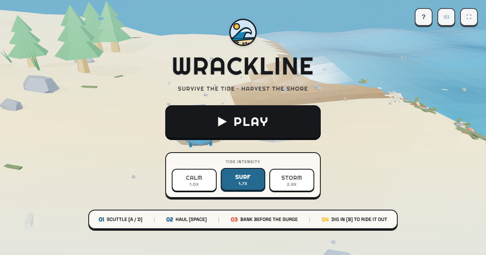
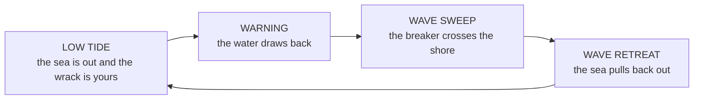
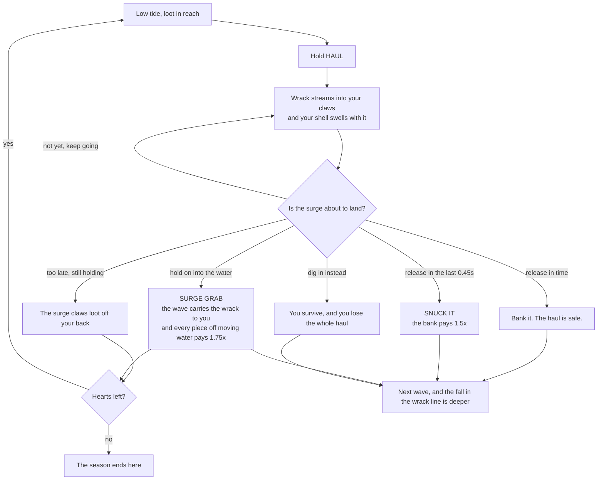
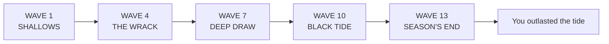
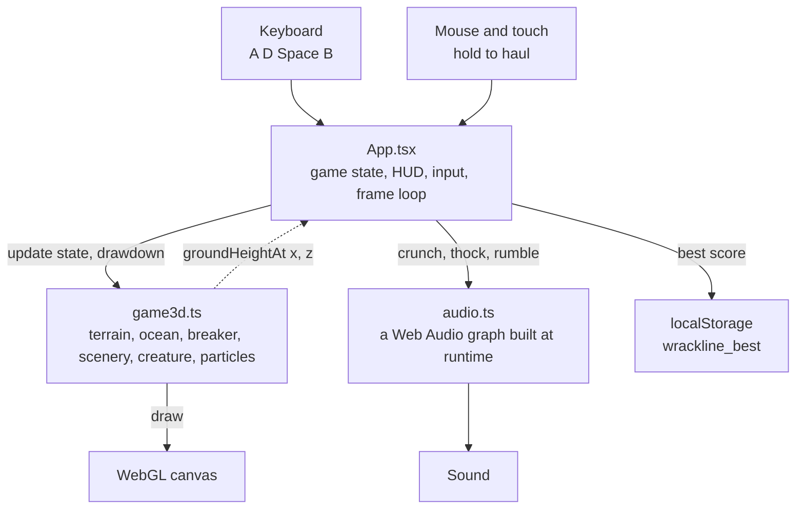

<div align="center">
  
  <h1>WRACKLINE</h1>
  <p><strong>Survive the tide. Harvest the shore.</strong><br />
  A seaside arcade game about greed, timing, and thirteen waves of incoming water.</p>

  <p>
    <a href="https://wrackline.vercel.app"></a>
    <a href="LICENSE"></a>
    <a href="https://github.com/thesithunyein/wrackline/commits/main"></a>
    <a href="https://github.com/thesithunyein/wrackline/stargazers"></a>
  </p>

  <p>
    
    
    
    
    
  </p>

  <p>
    
    
    <a href="CONTRIBUTING.md"></a>
  </p>
</div>



## What this is

A seaside arcade game about tide timing and loot hauling. You are a hermit scuttler working a
storm beach: hold your nerve through the low tide, pull the wrack into your shell, and get off the
sand before the breaker lands on top of you.

Every wave gives you the same choice, and it is the whole game. The longer you hold, the more you
stand to bank, and the more the surge can tear off your back.

**Play it:** https://wrackline.vercel.app (a keyboard, a mouse or a thumb all work)

## Contents

- [How to play](#how-to-play)
- [How it works](#how-it-works)
- [Running it locally](#running-it-locally)
- [Deployment](#deployment)
- [How it is built](#how-it-is-built)
- [Project layout](#project-layout)
- [Contributing](#contributing)
- [Security](#security)
- [License](#license)

## How to play

| Action | Keys | What it does |
|---|---|---|
| **Scuttle** | `A` / `D` or `←` / `→` | Walk the shore. Deeper sand holds richer wrack and a longer walk back. |
| **Haul** | Hold `Space`, or hold the screen | Everything within claw reach, about six units of beach either side of you, streams into your shell. Everything further out stays where it lies until you scuttle over to it, which is the whole reason the far, fatter pieces are worth more. The water counts as reach: hauling while the surge is on the shore pays **1.75x**. Keep holding and your shell swells, and a swollen shell is a wider target. |
| **Bank** | Release `Space` | The haul is stowed and safe. It counts immediately. |
| **Dig in** | Hold `B` or `Shift` | Burrow under the sand. The surge passes over you, and it takes everything you were holding. A 0.3 second wind-up makes it a commitment rather than a reflex. |
| **Pick the tide** | `1` / `2` / `3` on the title screen | Calm, Surf or Storm. |

Walking is not the risk. Holding is. Releasing your haul the instant the water arrives is the
difference between a good wave and a lost one.

Holding into the water is its own gamble, and the game is built to reward it. While the surge is on
the shore the wrack floats, and the wave carries it: the breaker pushes it up the beach as it runs
in and drags it back out as it leaves. A piece you could not reach in the low tide can therefore be
lifted straight off the moving water for **1.75x** its worth, and the grab says `SURGE`. What it
costs is the old rule, unchanged: a surge that catches you holding takes a heart, and while it has
you the water claws pieces back off your back about twice a second. The bonus is what that risk
buys, not free money.

### Tides

| Tide | Multiplier | Low tide | Warning | Hearts | Character |
|---|---|---|---|---|---|
| CALM | 1.0× | 7.0s | 1.8s | 4 | Long low tide, slow breaker, forgiving window |
| SURF | 1.7× | 5.0s | 1.3s | 3 | The default. A fair fight between greed and escape |
| STORM | 2.8× | 3.6s | 0.9s | 2 | Short low tide, fast breaker, slower claws |

### The season

A run is **thirteen waves**. Survive all of them and you have outlasted the tide. Hearts are the
only losing condition, so water never ends a run by surprise, and the wrack line never kills you.
It just keeps eating the shore, which makes the closing waves thinner pickings.

| Waves | Stretch |
|---|---|
| 1 to 3 | SHALLOWS |
| 4 to 6 | THE WRACK |
| 7 to 9 | DEEP DRAW |
| 10 to 12 | BLACK TIDE |
| 13 | SEASON'S END |

The calm between surges shrinks all season rather than flattening out at wave seven, so wave
thirteen is genuinely the tightest wave in the run.

### Three moments the game is built around

- **The King Tide.** From wave three on, a wave can roll in as a King Tide and pay **double** on
  everything you bank during it. The odds climb as the run goes on, it never lands twice in a row,
  and three dry waves guarantee the next one rolls. It is the reason a cautious run still has a
  moment worth gambling on.
- **The snuck bank.** Release your haul inside the last 0.45 seconds of the warning, with the surge
  already moving, and the bank pays a **1.5× near miss bonus**, once per wave. Ten frames of
  slow motion mark it. This is the moment a run gets remembered for, and it only pays once per
  wave on purpose: if every bank paid the bonus, the greed decision would stop meaning anything.
- **The surge grab.** The water is the threat, and it is also the best larder on the beach. Haul
  while the surge is on the shore and the wave carries wrack to your claws for **1.75x**, so the
  pieces left stranded up at the waterline come to you instead of going back out with the tide.

Get caught holding loot and the surge claws it off your back, about twice a second, and you lose a
heart. Lose the last one and the wave takes you.

## How it works

Four views of the same machine, from the tide itself down to the code that draws it.

### The tide cycle

Every wave runs the same four phases. The breaker is a state machine, not a script.



### The decision

This is one wave from the player's side. Every arrow that says keep holding is a bet against the
next one.



### A run

Thirteen waves, four named stretches, one ending you want.



Later waves are tighter in three ways at once: the low tide window multiplies down as the run goes
on, the wrack line retreats eight units per surge so there is less to gather, and the King Tide odds
climb.

### How the code fits together



### Things worth knowing in the code

- **`src/game3d.ts` owns the scene.** Gameplay state lives in `App.tsx` and is pushed into the
  engine once per frame through `Wrackline3D.update()`.
- **`groundHeightAt( x, z )`** is the single source of truth for where the beach surface is.
  Scenery, loot and the player are all bedded onto it, so nothing floats or sinks as the slope
  changes across the shore.
- **The sea is calm where it meets the beach.** The swell is damped over the last fourteen units of
  shore, so the water surface is never below the sand it is meeting: the waterline is a line rather
  than a breathing band, and the draw bares beach instead of seabed.
- **The breaker is re-draped every frame.** `waterSurfaceY()` returns the waterline under the wave
  (the sand it is crossing, or sea level once the beach drops below it) and the swell, foam and
  shallow sheet are rebuilt on top of it. That is what keeps the surge attached to the sea instead
  of reading as a separate slab sliding over dry sand.
- **Greed is drawn, not just counted.** The shell visibly swells with the value riding on it, and
  that swell is read back as a hitbox, so a fat scuttler really is easier to catch than a lean one.
- **Every ending has a cause.** A run ends because hearts ran out or because thirteen waves were
  survived, and the end screen names which one.

## Running it locally

```bash
npm install --legacy-peer-deps   # npm's resolver trips over an esbuild peer range
npm run dev                      # http://localhost:3000
npm run build                    # production bundle in dist/
npm run lint                     # tsc --noEmit
```

`--legacy-peer-deps` is only needed for a clean install; an existing `node_modules` is fine.

## Deployment

The game is a static bundle, so any static host works. It is currently on Vercel:

```bash
npm run build
vercel deploy --prod        # from a directory holding index.html + assets/
```

Nothing at runtime is server-side: no API keys, no environment variables, no database. Clearing
site data is the only way to reset your best score, because that score is yours alone.

## How it is built

- **React 19 + TypeScript + Vite 8**, with Tailwind CSS v4 for the HUD and menus.
- **Three.js** renders the whole world: a faceted dune mesh and wet sand strip, an animated ocean,
  the breaker, and every prop. Flat shading with non-indexed geometry keeps the low-poly facets.
- **Web Audio** synthesises all sound at runtime, from the gasp of the warning to the crunch of the
  wrack line. No audio files ship with the game.
- **No art files either.** Geometry, the logo and the UI icons are all generated, so the only binary
  in the repository is the social card.
- **Two fonts** are the only thing fetched at runtime.

## Project layout

```
index.html          shell, fonts, tab icon
src/main.tsx        entry
src/App.tsx         game state, HUD, input, the frame loop
src/game3d.ts       Three.js world: terrain, ocean, breaker, scenery, creature, particles
src/Logo.tsx        the badge mark and wordmark
src/audio.ts        procedural Web Audio
docs/logo.svg       the mark on its own, for READMEs and press
public/og.png       social card
```

## Contributing

Bug reports, feel notes and pull requests are welcome. Read
[CONTRIBUTING.md](CONTRIBUTING.md) first: the short version is that greed is the timer, feel is the
product, and a change that makes holding less of a decision is probably not the change to make.

## Security

This is a static client-side game with no server, no accounts and no analytics. There is very
little to attack, and [SECURITY.md](SECURITY.md) says exactly what is worth reporting and what is
known and accepted. The score is stored in `localStorage` and can be edited by anyone. There is no
leaderboard, so that is a feature.

## Code of conduct

This project follows the [Contributor Covenant](CODE_OF_CONDUCT.md), version 2.1.

## License

[MIT](LICENSE). Copyright (c) 2026 Sithu Nyein.

## Credits

Built by **Sithu Nyein** ([sithunyein.mailto@gmail.com](mailto:sithunyein.mailto@gmail.com)).

World, sound, art and code are original to this project. Built on the shoulders of React, Three.js,
Vite and Tailwind, which are all MIT licensed.
